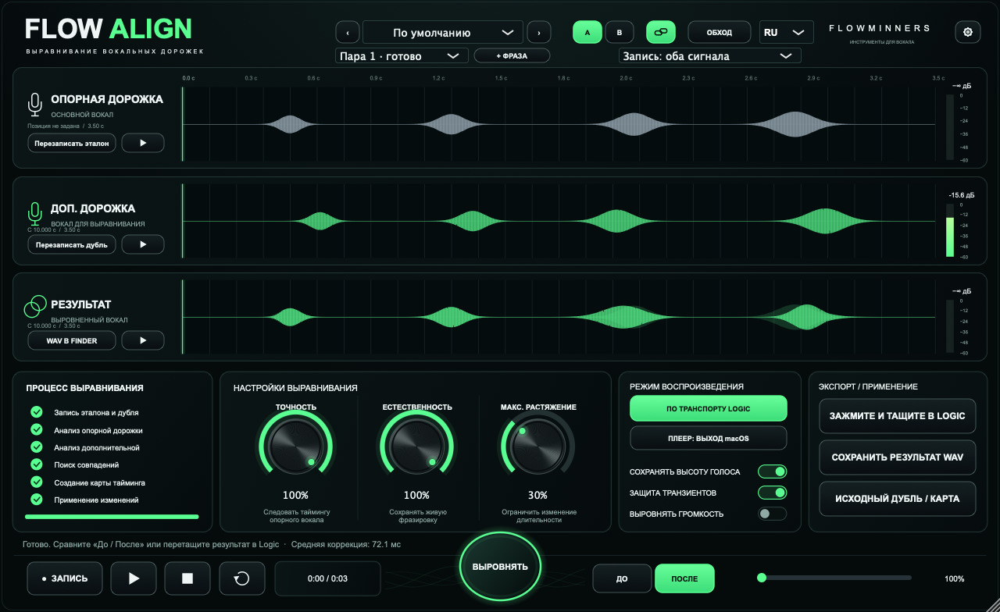

# FLOWALIGN

Выравнивание вокального дубля по эталону с сохранением высоты голоса. AU для macOS и VST3 для Windows.

Интерфейс **Русский / English**: переключатель **RU / EN** справа от «Обход». Язык сохраняется в проекте.

- Импорт аудиофайлов и регионов, захват через Side Chain.
- Точность, естественность и предел растяжения; до восьми пар фраз.
- Прослушивание эталона, дубля и результата, сравнение «До / После».
- Экспорт WAV и карты тайминга CSV, перенос WAV в секвенсор.

## Скачать

| Система | Формат | Установщик |
|---|---|---|
| macOS 12+ · Apple Silicon и Intel | AU | [PKG](https://github.com/Abynarc/FLOWALIGN/releases/download/v0.5.0/FLOWALIGN-0.5.0-Universal.pkg) |
| Windows 10/11 · x64 | VST3 | [EXE](https://github.com/Abynarc/FLOWALIGN/releases/download/v0.5.0/FLOWALIGN-0.5.0-Windows-x64-Setup.exe) |

Перед установкой сохраните проект и закройте секвенсор. Установщики без сертификата издателя.

[Установка macOS](docs/INSTALL.md) · [Установка Windows](docs/INSTALL-WINDOWS.md) · [Windows installation](docs/INSTALL-WINDOWS-EN.md) · [English interface](docs/images/flowalign-en.png) · [Сборка](BUILDING.md) · [Все релизы](https://github.com/Abynarc/FLOWALIGN/releases)
