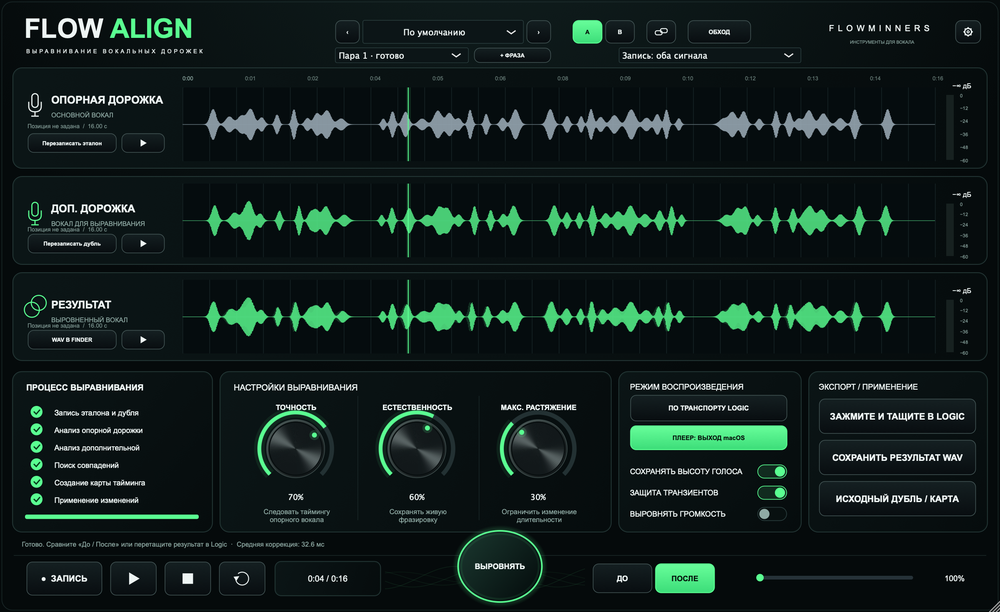

# FLOWALIGN

**Выравнивание вокальных дублей по эталону в Logic Pro.** Audio Unit от **FLOWMINNERS** с русским интерфейсом, тремя осциллограммами и сохранением фрагментов внутри проекта.

[**Скачать установщик 0.3.2**](https://github.com/Abynarc/FLOWALIGN/releases/tag/v0.3.2) · [Установка](docs/INSTALL.md) · [История изменений](CHANGELOG.md)



*Снимок настоящего редактора FLOWALIGN 0.3.2 на синтетическом демонстрационном аудио. Результат рассчитан алгоритмом плагина. Личные записи и проекты в репозитории отсутствуют.*

## Для чего

Вы записали основной вокал и дубль одной фразы. FLOWALIGN анализирует их тайминг и строит карту времени, чтобы приблизить фразировку дубля к эталону. После расчёта можно отдельно послушать каждый сигнал, сравнить «До / После» и перенести результат в Logic.

Алгоритм сопоставляет огибающие и атаки с помощью DTW. Для обработки с сохранением высоты используется WSOLA с общими смещениями стереоканалов. Распознавание слов не применяется; лучше всего подходят исполнения одной фразы с близкой структурой.

## Возможности

| Возможность | Что доступно в 0.3.2 |
|---|---|
| Три осциллограммы | Опорная дорожка, исходный дубль, рассчитанный результат; масштаб и перемещение позиции |
| Перенос регионов из Logic | Приём одного готового аудиорегиона в каждую входную волну через AppKit file promises; очередь быстрых переносов |
| Проверка длины регионов | В новом пути переноса длины должны совпадать; при ошибке прежняя пара и результат сохраняются |
| Запись с таймлайна | Захват основного входа и Side Chain вместе или по отдельности, включая разные позиции проекта |
| Выравнивание | Точность, естественность, предел локального растяжения, сохранение высоты, защита транзиентов |
| Громкость | Дополнительное выравнивание RMS с ограничением усиления и пиков |
| Прослушивание | Отдельная кнопка у каждого сигнала, «До / После», остановка, повтор и seek; системный выход macOS |
| Воспроизведение по транспорту | Подстановка результата в сохранённом диапазоне Logic; вне диапазона проходит исходный вход |
| Несколько фраз | До восьми пар на экземпляр, переключение пар и восстановление параметров рассчитанной пары |
| Состояние проекта | Сохранение аудиобуферов, результатов, карты времени и позиций в состоянии плагина |
| Перенос результата | Перетаскивание автоматически подготовленного WAV в Logic; альтернативный доступ к файлу через Finder |
| Файлы | Импорт поддерживаемых JUCE/macOS форматов; экспорт результата и исходного дубля в WAV 24 bit, карты тайминга в CSV |

## Установка

1. Скачайте `FLOWALIGN-0.3.2-Universal.pkg` из [Releases](https://github.com/Abynarc/FLOWALIGN/releases/tag/v0.3.2).
2. Сохраните проект и закройте Logic Pro.
3. Откройте `.pkg`, следуйте шагам установщика и введите пароль администратора.
4. Откройте Logic: **Audio FX → Audio Units → FLOWMINNERS → FLOWALIGN**.

Установщик помещает AU в `/Library/Audio/Plug-Ins/Components`. Прежняя системная копия резервируется. Прежняя пользовательская копия текущего пользователя переносится в резервные копии после проверки нового AU, чтобы не перекрывать его. Другие учётные записи не изменяются.

**Подпись:** AU подписан ad hoc; установщик не имеет Developer ID и нотариального заверения Apple. При блокировке этого файла используйте **Системные настройки → Конфиденциальность и безопасность → Всё равно открыть**. [Инструкция Apple](https://support.apple.com/102445). Полное отключение Gatekeeper не требуется.

Подробнее о резервных копиях, проверке SHA-256 и поиске плагина: [INSTALL.md](docs/INSTALL.md).

## Быстрый сценарий: два готовых региона

1. Вставьте FLOWALIGN на дорожку дубля и откройте окно.
2. Заранее обрежьте эталон и дубль до одинаковой длины в Logic.
3. Перетащите **один регион** на область осциллограммы «Опорная дорожка», второй — на «Доп. дорожка». Можно в любом порядке. Кнопки записи нажимать не нужно.
4. Дождитесь загрузки и проверьте сигналы кнопками «Слушать».
5. Настройте обработку и нажмите **«Выровнять»**. Третья осциллограмма показывает результат.
6. Сравните «До / После». Зажмите кнопку **«Зажмите и тащите в Logic»** и перетащите её на таймлайн. Если перенос недоступен, откройте **«WAV в Finder»** у результата.

При разной длине новый регион отклоняется; прежние сигналы и результат сохраняются. Допуск — один сэмпл более низкой исходной частоты для округления границ. Новая пара добавляется кнопкой **«+ Фраза»**. Эта проверка относится к новому пути file promises; прежний импорт обычных файлов сохраняет свои правила.

File promise передаёт аудио, но не подтверждённую позицию региона в проекте. Для подстановки по транспорту поставьте курсор Logic на начало дубля, нажмите кнопку связи и включите режим транспорта. Для отдельного плеера привязка не нужна. Результат при обратном переносе размещается пользователем.

## Сценарий с записью через Side Chain

1. Поставьте плагин на дубль. В **Side Chain в заголовке окна Logic** выберите эталон. Mute/Solo не выбирают источник эталона.
2. Для совпадающих позиций выберите «Оба сигнала», поставьте курсор на начало фразы, нажмите «Запись», затем **Play в Logic**.
3. Для разных позиций запишите сначала эталон, затем дубль с нужного места. Запись одного входа сохраняет второй.
4. Остановите транспорт или завершите захват кнопкой плагина. Дождитесь осциллограмм и нажмите «Выровнять».

При захвате сохраняются позиции фрагментов. Остановка, скачок позиции или переход цикла завершают захват, когда хост передаёт соответствующее состояние. Во время записи сигнал проходит без подстановки прежнего результата. Микрофон и включение Record на дорожке не нужны: записываются уже существующие регионы при воспроизведении.

## Параметры

| Параметр | Назначение | По умолчанию |
|---|---|---|
| Точность | Степень применения карты тайминга; при 0% время дубля не меняется | 70% |
| Естественность | Сглаживание карты, сохранение живой фразировки | 60% |
| Макс. растяжение | Ограничение локального изменения длительности | 30% |
| Сохранять высоту голоса | WSOLA; при отключении применяется интерполяция, способная менять высоту | Включено |
| Защита транзиентов | Более короткие окна обработки для атак | Включено |
| Выровнять громкость | RMS-сопоставление с ограничением усиления и пиков | Выключено |

После изменения ручек нажмите «Выровнять» повторно. До пересчёта последний результат остаётся доступен для прослушивания, сравнения и экспорта; интерфейс сообщает, что параметры изменились. Пресеты и A/B переключают настройки.

## Совместимость и ограничения

- **Формат:** AU Audio Effect для macOS. VST, AAX и Windows-сборки отсутствуют.
- **Универсальная сборка:** arm64 и x86_64, минимальная macOS в исполняемом файле — 12.0. Проверки выполнены на Apple Silicon с macOS 27; исполнение на Intel и macOS 12 отдельно не проверялось. Требования выбранной версии Logic нужно учитывать отдельно.
- **Материал:** моно/стерео, 8–192 кГц, до 120 секунд на вход; общий предел аудио — 256 МиБ. Длина захвата может сокращаться при нехватке памяти. Поиск смещений ограничен тремя секундами.
- **Плеер:** использует системный выход macOS, который может отличаться от выхода Logic. Для изолированного прослушивания остановите транспорт Logic.
- **Интеграция:** нет ARA, автоматического чтения всех тейков, автоматического запуска Play или создания дорожки одним кликом. Плагин принимает переданный регион; автоматически извлекать всё содержимое дорожки он не умеет.
- **Перенос из Logic:** реальная выдача двух AIFF через file promise проверена в диагностическом приёмнике; адаптер AU и очередь покрыты контролируемыми тестами. Прямой перенос в окно AU и совместимость разных версий Logic требуют ручной проверки.
- **Проверка качества:** алгоритм не понимает слова и не гарантирует совпадение артикуляции. Результат нужно оценивать прослушиванием. Предупреждение Logic «Sample Rate 15 987 recognized» в тестах не воспроизведено; его причина не установлена.

Подготовленные WAV для обратного переноса хранятся в `~/Library/FLOWMINNERS/FLOWALIGN/Results`. Скопируйте используемое аудио внутрь проекта средствами Logic перед переносом проекта на другой компьютер. Не удаляйте файлы, на которые ссылается проект.

## Сборка из исходников

Нужны macOS, Xcode Command Line Tools, CMake 3.22+, C++17, Python 3 для служебных скриптов и JUCE 9.0.4. JUCE не включён в репозиторий. Проверенный commit: `454fe891acc8204f99f4ef1e3a28c84b1a4da145`.

```bash
git clone https://github.com/juce-framework/JUCE.git ../JUCE
git -C ../JUCE checkout 454fe891acc8204f99f4ef1e3a28c84b1a4da145
cmake -S . -B build-distribution -G 'Unix Makefiles' \
  -DCMAKE_BUILD_TYPE=Release \
  '-DCMAKE_OSX_ARCHITECTURES=arm64;x86_64' \
  -DCMAKE_OSX_DEPLOYMENT_TARGET=12.0
cmake --build build-distribution --target FLOWALIGN_AU -j6
python3 packaging/build_distribution.py --skip-build
```

Для другого расположения JUCE передайте `-DJUCE_PATH=/path/to/JUCE` при конфигурации. Готовый AU находится в `build-distribution/FLOWALIGN_artefacts/Release/AU`, установщик — в `dist`. Если система не позволяет создавать DMG, скрипт оставляет готовый самостоятельный PKG.

Сведения о зависимости: [THIRD_PARTY.md](THIRD_PARTY.md). В репозитории находятся только исходники плагина, средства сборки и установки, документация и скриншот. Тестовые программы, отчёты, аудиозаписи и проекты Logic в публикацию не включены.
