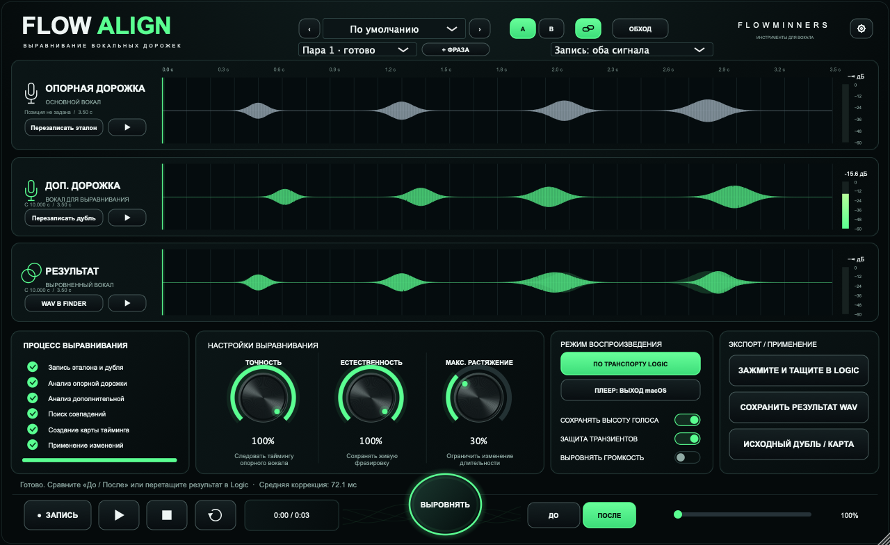

# FLOWALIGN

Выравнивает вокальный дубль по эталону, сохраняя высоту голоса. AU для macOS и VST3 для Windows.

- Импорт аудиофайлов и регионов или захват дорожек через Side Chain.
- Настройка точности, естественности и растяжения. Точность и естественность по умолчанию — 100%.
- До восьми пар фраз с сохранением аудио и результатов в проекте.
- Прослушивание эталона, дубля и результата, сравнение «До / После».
- Экспорт WAV и перенос результата обратно в секвенсор.

## Скачать и установить

| Система | Формат | Установщик |
|---|---|---|
| macOS 12+ · Apple Silicon и Intel | AU | [Скачать PKG](https://github.com/Abynarc/FLOWALIGN/releases/download/v0.4.1/FLOWALIGN-0.4.1-Universal.pkg) |
| Windows 10/11 · x64 | VST3 | [Скачать EXE](https://github.com/Abynarc/FLOWALIGN/releases/download/v0.4.1/FLOWALIGN-0.4.1-Windows-x64-Setup.exe) |

Закройте секвенсор и запустите установщик. В Logic: **Audio FX → Audio Units → FLOWMINNERS → FLOWALIGN**. В FL Studio: **Manage plugins → Find installed plugins**.

Добавьте эталон и дубль, нажмите **«Выровнять»**, прослушайте результат и перетащите готовый WAV на таймлайн. Для переноса регионов подготовьте фрагменты одинаковой длины; через меню можно загрузить файлы разной длины.

Моно и стерео, до 120 секунд на фрагмент. Установщики пока без сертификата издателя.

[Все релизы](https://github.com/Abynarc/FLOWALIGN/releases) · [Установка Windows и Side Chain](docs/INSTALL-WINDOWS.md)
