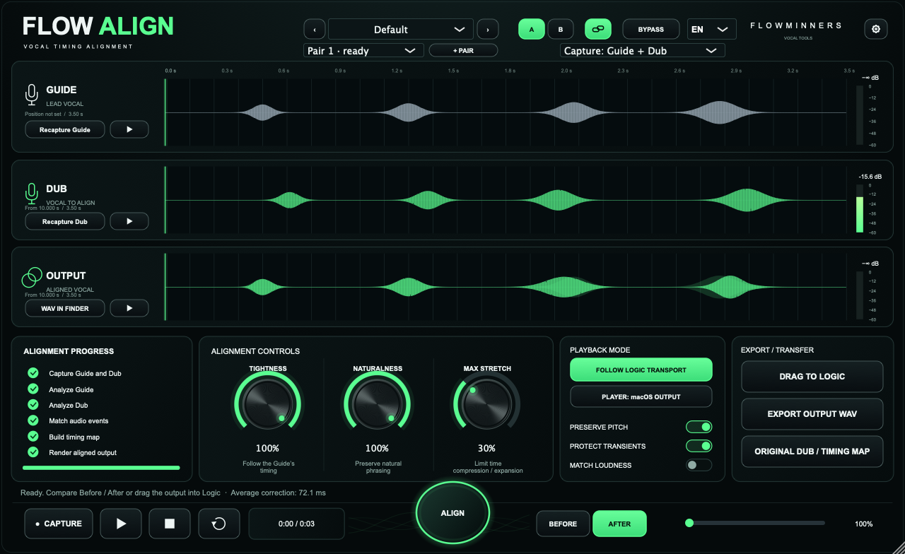
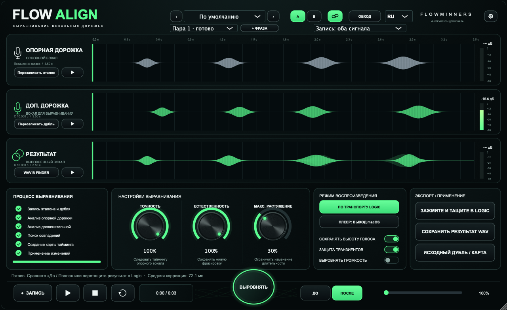

# RU / EN interface — FLOWALIGN and FLOWTONE

## Terminology research (2026-11-03)

Primary sources:

- [Synchro Arts: VocAlign interface and operation](https://www.synchroarts.com/manuals/VocAlign6Standard/Manual/HTML/user-interface-and-operation.html): Guide, Dub, Output, Capture and Render.
- [Synchro Arts: automatic time matching](https://www.synchroarts.com/manuals/VocAlign6Standard/Manual/HTML/adjusting-the-automatic-time-matching.html): tightness, time compression/expansion, and the distinction between Maximum Shift and stretch limits.
- [Soundtoys: Little AlterBoy manual](https://www.soundtoys.com/wp-content/uploads/Little-AlterBoy-Manual.pdf): Pitch, Formant, semitones, Transpose. FLOWTONE preserves formants; it does not offer an independent Formant Shift knob.
- [Steinberg: WaveLab Pro operation manual](https://archive.steinberg.help/wavelab_pro/v9.5/en/WaveLab_Pro_9_5_Operation_Manual_en.pdf): Preserve Formants and quality modes.
- [Eventide: MicroPitch Immersive user guide](https://downloads.eventide.com/audio/manuals/plug-ins/MicroPitch%2BImmersive%2BUser%2BGuide.pdf): Output Gain.
- [zplane: deCoda quick reference](https://products.zplane.de/uploads/Installers-Manuals/DECODA/deCoda_quick_reference.pdf): detected key, tempo and transposition.

The wording below is a product-specific choice based on the actual controls, not a claim that competing plug-ins have identical algorithms.

| Plugin | Russian | English | Meaning |
|---|---|---|---|
| FLOWALIGN | Опорная дорожка | Guide | Timing reference |
| FLOWALIGN | Доп. дорожка | Dub | Audio being aligned |
| FLOWALIGN | Результат | Output | Rendered aligned audio |
| FLOWALIGN | Запись | Capture | Capture audio from the host |
| FLOWALIGN | Точность | Tightness | Amount of timing alignment |
| FLOWALIGN | Естественность | Naturalness | Timing-map smoothing |
| FLOWALIGN | Макс. растяжение | Max Stretch | Local time compression / expansion limit, not time offset |
| FLOWALIGN | Выровнять громкость | Match Loudness | Match Dub loudness to Guide |
| FLOWALIGN | Слушать | Audition | Isolated system-output playback |
| FLOWTONE | Изменение тона | Pitch Shift | Transposition without changing duration |
| FLOWTONE | Сохранять тембр | Preserve Formants | Compensate formant movement |
| FLOWTONE | Онлайн / Файл | Live / File | Track-input or entire-file analysis |
| FLOWTONE | Тональность | Key | Musical key, not individual note pitch |
| FLOWTONE | Громкость выхода | Output Gain | Output level adjustment in dB |
| Both | До / После | Before / After | Original and processed audio comparison |
| Both | Обход | Bypass | Disable processing |

## Layout and behaviour

The English layouts are in each plugin's `docs/localisation/english-layout.svg`.
The existing graphite/green design and control placement are retained. A keyboard-accessible language dropdown fits between Bypass and the brand, at x=1215 in the 1600-unit layout. Its choices are always RU and EN, so either language remains discoverable. Default is Russian, including projects saved before this feature. The language is per plug-in instance and saved in the project. Switching is immediate, changes no processing parameter, does not apply a preset and does not reset analysis or rendered audio.

All visible strings, menus, tooltips, dialogs, help, status/error messages and units are covered. Filenames and host track names remain user data. Host automation IDs, parameter order/ranges/defaults and DSP are preserved. Host parameter display names retain their existing registration, since hosts cache these independently of the custom editor.

Catalogs are `Source/Translations.json`. Generated headers must stay in sync. UI tests must exercise the dropdown in both directions, editor recreation, state restoration, old projects, independent instances, both layouts, actual processing and analysis. Final screenshots come from the real JUCE editors.

## Actual editors

The vector layout is the design reference. These images are snapshots of the actual JUCE editors with synthetic audio:

